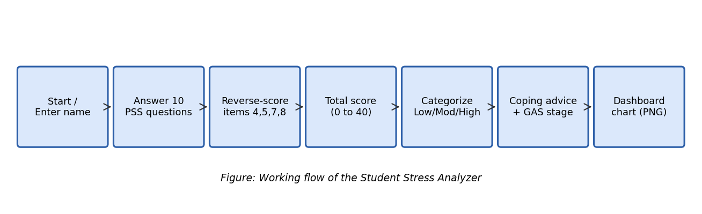

 <div align="center">

# STRESS ANALYZER

### MEASURE. REFLECT. RESPOND.

**A minimal, data-driven approach to understanding perceived stress.**

<br/>

<a href="https://github.com/DivyangUGitHub/stress-analyzer">
  
</a>


<br/><br/>

[OVERVIEW](#-overview) · [FEATURES](#-features) · [METHODOLOGY](#-methodology) · [INSTALLATION](#-installation) · [ROADMAP](#-roadmap)

<br/>

</div>

---

## 01 / OVERVIEW

> **Stress is easy to experience. Harder to understand.**

Stress Analyzer is a Python-based academic mini project that transforms the PSS-10 questionnaire into a structured self-awareness report, score visualization, and practical coping suggestions.

Designed around clarity, reproducibility, and responsible interpretation.

<br/>

<div align="center">

|  PROJECT | DETAILS |
|:--|:--|
| **Category** | B.Tech CSE · Mini Project |
| **Course** | Understanding Self for Effectiveness and Personality Development |
| **Unit** | 04 — Stress and Coping Strategies |
| **Assessment** | Perceived Stress Scale (PSS-10) |
| **Language** | Python 3.8+ |
| **Visualization** | Matplotlib |
| **Output** | Console Report + PNG Dashboard |

</div>

---

## 02 / THE PROCESS

<div align="center">



</div>

### From questionnaire to insight

**01 — INPUT**  
Collect ten responses, each between 0 and 4.

**02 — VALIDATION**  
Reject invalid entries and out-of-range values.

**03 — SCORING**  
Reverse-score positively phrased items 4, 5, 7, and 8.

**04 — ANALYSIS**  
Calculate the total score and normalized score index.

**05 — FEEDBACK**  
Present the project's descriptive category and coping suggestions.

**06 — VISUALIZATION**  
Generate a dashboard with score position and simulated group statistics.

---

## 03 / FEATURES

<div align="center">

| 01 / SCORING | 02 / VALIDATION |
|:--|:--|
| Automatic reverse scoring | Integer input from 0–4 |
| Total score from 0–40 | Invalid input handling |
| Normalized score index | Clear user prompts |

| 03 / FEEDBACK | 04 / VISUAL ANALYTICS |
|:--|:--|
| Category-specific suggestions | Matplotlib dashboard |
| Practical coping strategies | Score distribution |
| Self-awareness focus | Simulated group comparison |

</div>

---

## 04 / DASHBOARD PREVIEW

<div align="center">


<sub>EXAMPLE DASHBOARD · SIMULATED COMPARISON DATA</sub>

</div>

The dashboard is designed to make numerical results easier to understand at a glance.

- **Score position** — see the score on a 0–40 scale.
- **Distribution** — compare against a simulated score distribution.
- **Category share** — explore the proportions in the illustrative dataset.

---

## 05 / METHODOLOGY

### Reverse scoring

For the positively phrased items 4, 5, 7, and 8:

```text
Adjusted response = 4 − original response
```

### Total score

```text
PSS-10 = Sum of all 10 scored responses
Range  = 0–40
```

### Normalized score index

```text
Index (%) = (PSS-10 / 40) × 100
```

### Illustrative score categories

| SCORE | CATEGORY |
|:--:|:--|
| 0–13 | LOW |
| 14–26 | MODERATE |
| 27–40 | HIGH |

These categories are configurable project conventions, not universal clinical thresholds. The PSS-10 measures perceived stress and is not a diagnostic test.

Selye's alarm, resistance, and exhaustion stages are a separate theoretical framework and cannot be reliably inferred from the PSS-10 total alone.

---

## 06 / INSTALLATION

### Prerequisites

- Python 3.8+
- pip
- Git

### Clone the repository

```bash
git clone https://github.com/DivyangUGitHub/stress-analyzer.git

cd stress-analyzer
```

### Install dependencies

```bash
pip install -r requirements.txt
```

### Run the application

```bash
python stress_analyzer.py
```

### Run tests

```bash
python tests.py
```

The application prints a console report and generates `dashboard.png` when execution completes successfully.

---

## 07 / PROJECT STRUCTURE

```text
stress-analyzer/
│
├── stress_analyzer.py
├── tests.py
├── requirements.txt
│
├── assets/
│   ├── console.png
│   ├── dashboard.png
│   └── flowchart.png
│
├── docs/
│   └── project-report.docx
│
├── LICENSE
└── README.md
```

---

## 08 / ROADMAP

- [ ] Interactive web interface
- [ ] Tkinter desktop interface
- [ ] Optional local score history
- [ ] Guided breathing timer
- [ ] Exportable personal reports
- [ ] Accessible interface and keyboard navigation
- [ ] Anonymous group analytics with appropriate consent

---

## 09 / ETHICS & LIMITATIONS

<div align="center">

**SELF-AWARENESS TOOL · NOT A MEDICAL DIAGNOSIS**

</div>

- Results are based on self-reported answers.
- Score categories are illustrative project settings.
- Comparison data is simulated, not real student research.
- Personal responses should be handled with appropriate privacy safeguards.
- Persistent distress may warrant support from a qualified mental health professional.

---

## 10 / REFERENCES

1. Cohen, S., Kamarck, T., & Mermelstein, R. (1983). *A global measure of perceived stress.* Journal of Health and Social Behavior, 24(4), 385–396.
2. Selye, H. (1956). *The Stress of Life.* McGraw-Hill.
3. Lazarus, R. S., & Folkman, S. (1984). *Stress, Appraisal, and Coping.* Springer.

---

<div align="center">

### BUILT FOR SELF-AWARENESS.

**STRESS ANALYZER / 2026**

<sub>B.Tech Computer Science and Engineering</sub>

<sub>SRM Institute of Science and Technology · NCR Campus</sub>

<br/>

**AUTHOR:** [Your Name]  
**ROLL NUMBER:** [Your Roll Number]  
**SUPERVISOR:** Mr. A. Kathiresan

<br/>

<a href="https://github.com/DivyangUGitHub">
  
</a>

<br/><br/>

<sub>MEASURE. REFLECT. RESPOND.</sub>

</div>
