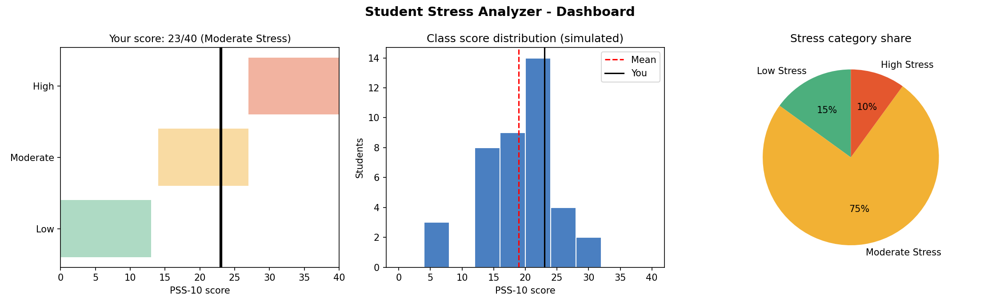
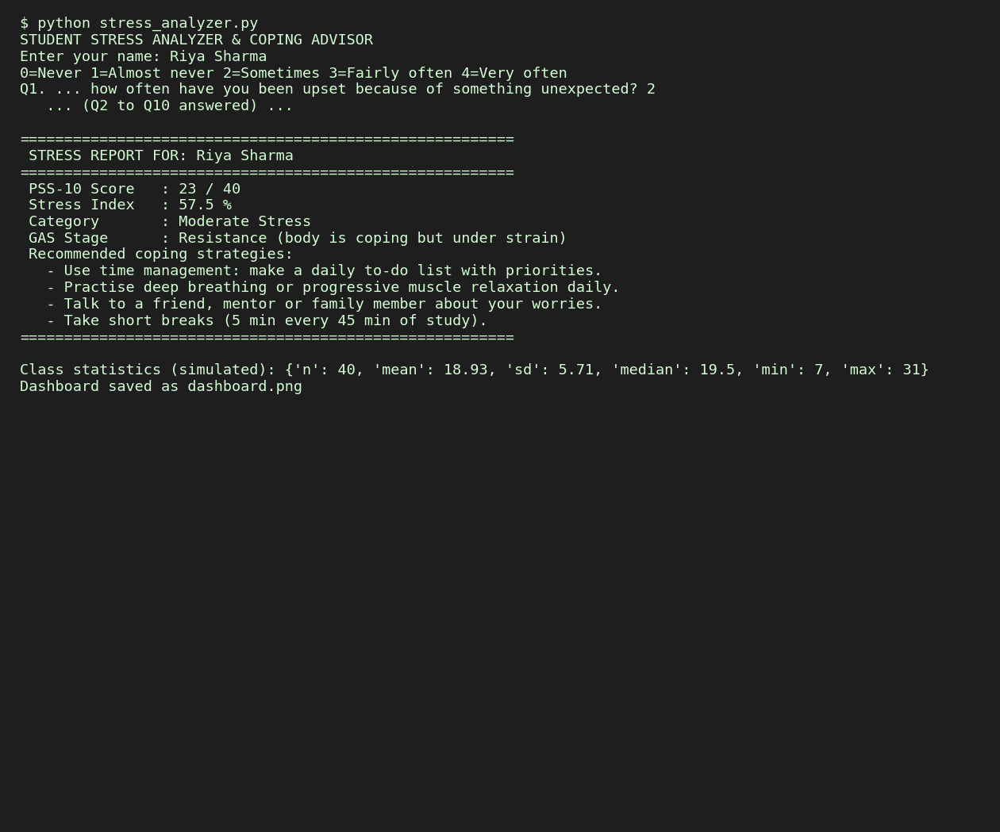

 <div align="center">


# STRESS<br/>ANALYZER<span style="color:#FF3030">.</span>

### MEASURE. REFLECT. RESPOND.

**A Python-powered exploration of perceived stress and self-awareness.**

Turning questionnaire responses into understandable scores, practical coping suggestions, and visual insights.

<br/>

<a href="https://github.com/DivyangUGitHub/stress-analyzer">
  
</a>


<br/><br/>

[OVERVIEW](#01--overview) / [FEATURES](#02--features) / [DASHBOARD](#03--dashboard) / [METHODOLOGY](#04--methodology) / [GET STARTED](#05--get-started)

<br/>



<br/>

<sub>ACADEMIC MINI PROJECT / BEHAVIORAL PSYCHOLOGY × SOFTWARE ENGINEERING</sub>

</div>

---

<div align="center">

## 01 — OVERVIEW

### Understand the numbers behind the feeling.

</div>

Stress Analyzer is a Python-based mini project that uses the Perceived Stress Scale (PSS-10) questionnaire to calculate a perceived-stress score and provide educational feedback.

It combines behavioral psychology concepts with input validation, numerical computation, automated reporting, and data visualization.

<table>
<tr>
<td width="50%" valign="top">

**01 / MEASURE**

Collect ten questionnaire responses and validate every entry.

</td>
<td width="50%" valign="top">

**02 / CALCULATE**

Apply reverse scoring and calculate the total score.

</td>
</tr>
<tr>
<td width="50%" valign="top">

**03 / INTERPRET**

Display an illustrative project category and coping suggestions.

</td>
<td width="50%" valign="top">

**04 / VISUALIZE**

Generate a dashboard with score comparisons and simulated data.

</td>
</tr>
</table>

### Project information

| ATTRIBUTE | DETAILS |
|:--|:--|
| Project | Stress Analyzer |
| Degree | B.Tech Computer Science and Engineering |
| Course | Understanding Self for Effectiveness and Personality Development |
| Unit | 04 — Stress and Coping Strategies |
| Questionnaire | PSS-10 |
| Language | Python 3.8+ |
| Visualization | Matplotlib |
| Interface | Command-line application |

---

<div align="center">

## 02 — FEATURES

### Small application. Multiple layers of engineering.

</div>

| MODULE | CAPABILITIES |
|:--|:--|
| **Input Engine** | Ten responses, range checks, invalid-input handling |
| **Scoring Engine** | Reverse scoring and total score calculation |
| **Feedback Engine** | Illustrative score categories and coping suggestions |
| **Visualization Engine** | Score position, distribution and category-share charts |
| **Testing** | Boundary cases and automated test script |
| **Reporting** | Console report and PNG dashboard |

<div align="center">


</div>

---

<div align="center">

## 03 — DASHBOARD

### From raw responses to visual information.

</div>

<div align="center">



<sub>FIG. 01 / CONSOLE OUTPUT</sub>

<br/><br/>


<sub>FIG. 02 / DATA VISUALIZATION</sub>

</div>

**Dashboard components**

- **Score position:** displays a score on the 0–40 scale.
- **Score distribution:** compares the score with simulated observations.
- **Category share:** visualizes the categories in the illustrative dataset.

> **DATA NOTE**
>
> Comparison data is simulated. It is not collected from actual students and must not be presented as real-world research.

---

## 04 — METHODOLOGY

### 4.1 / Reverse scoring

PSS-10 items 4, 5, 7 and 8 are positively phrased and require reverse scoring.

```python
adjusted_response = 4 - original_response
```

### 4.2 / Total score

```text
PSS-10 score = Sum of all 10 scored responses

Minimum score = 0
Maximum score = 40
```

Higher scores indicate greater perceived stress.

### 4.3 / Normalized index

```text
Index (%) = (PSS-10 score / 40) × 100
```

This percentage expresses the score relative to the scale's maximum. It is not a probability, diagnosis, or clinical severity measure.

### 4.4 / Illustrative categories

| SCORE RANGE | PROJECT CATEGORY |
|:--:|:--|
| 0–13 | LOW |
| 14–26 | MODERATE |
| 27–40 | HIGH |

These categories are project-defined for demonstration and are not universal clinical cutoffs.

### 4.5 / Example calculation

Input:

```text
2, 2, 3, 2, 2, 3, 2, 2, 2, 3
```

Result:

| METRIC | RESULT |
|:--|--:|
| Total score | 23 / 40 |
| Normalized index | 57.5% |
| Illustrative category | MODERATE |

The positive-item responses in this example are all 2, so their reversed values remain 2.

**Scientific distinction:** Selye's alarm, resistance, and exhaustion stages are part of a separate theoretical framework. They cannot be inferred reliably from the PSS-10 total score alone.

---

## 05 — GET STARTED

### Requirements

- Python 3.8 or later
- Git
- pip

### Installation

**Step 01 / Clone the repository**

```bash
git clone https://github.com/DivyangUGitHub/stress-analyzer.git
cd stress-analyzer
```

**Step 02 / Install dependencies**

```bash
pip install -r requirements.txt
```

**Step 03 / Run the application**

```bash
python stress_analyzer.py
```

**Step 04 / Run tests**

```bash
python tests.py
```

Answer each questionnaire prompt with a whole number between `0` and `4`.

The program is intended to print a console report and save a dashboard image when execution completes successfully.

---

## 06 — ARCHITECTURE

```text
stress-analyzer/
│
├── stress_analyzer.py
│   └── Questionnaire, scoring and reporting
│
├── tests.py
│   └── Automated tests and boundary cases
│
├── requirements.txt
│   └── Project dependencies
│
├── assets/
│   ├── console.png
│   ├── dashboard.png
│   └── flowchart.png
│
├── docs/
│   └── project-report.docx
│
├── LICENSE
└── README.md
```

Ensure that the listed files exist in the repository before relying on the structure or image previews.

---

## 07 — ROADMAP

Future development opportunities:

- [ ] Interactive web interface
- [ ] Desktop interface using Tkinter
- [ ] Optional local score history
- [ ] Guided breathing exercise timer
- [ ] Exportable personal reports
- [ ] Accessibility improvements
- [ ] Privacy-conscious group analytics
- [ ] Evaluation with consenting participants and appropriate research safeguards

---

## 08 — RESPONSIBLE USE

<div align="center">


### SELF-AWARENESS, NOT DIAGNOSIS.

</div>

- The PSS-10 measures perceived stress; it does not diagnose a mental health condition.
- Results depend on self-reported responses.
- The project's score categories are illustrative.
- Simulated group statistics are not evidence about a real population.
- Personal responses should be handled with appropriate privacy safeguards.
- People experiencing persistent distress may benefit from speaking with a qualified mental health professional.

---

## 09 — REFERENCES

1. Cohen, S., Kamarck, T., & Mermelstein, R. (1983). A global measure of perceived stress. *Journal of Health and Social Behavior*, 24(4), 385–396.
2. Selye, H. (1956). *The Stress of Life.* McGraw-Hill.
3. Lazarus, R. S., & Folkman, S. (1984). *Stress, Appraisal, and Coping.* Springer.

---

<div align="center">


<br/><br/>

# MEASURE.<br/>REFLECT.<br/>RESPOND.

**STRESS ANALYZER / 2026**

B.Tech Computer Science and Engineering  
SRM Institute of Science and Technology · NCR Campus

<br/>

**AUTHOR:** Divyang Upreti  

<br/>

<a href="https://github.com/DivyangUGitHub">
  
</a>

<br/><br/>

<sub>AN ACADEMIC PROJECT AT THE INTERSECTION OF SOFTWARE ENGINEERING AND BEHAVIORAL PSYCHOLOGY.</sub>

</div>
